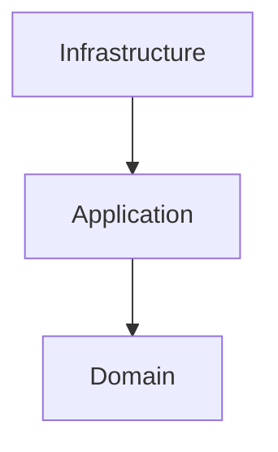

# Motor Desk


Motor Desk is a backend API for automotive repair shop management built with Kotlin and Ktor 3. The codebase follows a
hexagonal style with domain ports, application use cases, and infrastructure adapters. It manages service orders,
customers, vehicles, tasks, inventory items, approvals, authentication, service order history, and asynchronous email
notifications.

## Technologies

- Kotlin
- Ktor 3
- PostgreSQL + Exposed
- MongoDB for Service Order history
- Redis Streams for asynchronous email processing
- JWT authentication
- Docker Compose
- OpenAPI + Swagger UI

## Architecture

### Hexagonal Structure



The main code locations are:

```text
src/main/kotlin
├── domain
├── application
└── infrastructure
```

## Documentation

- [Ubiquitous Language](docs/Ubiquitous%20Language.md)
- [Database design — relational model, data ownership and performance](docs/database-design.md)
- [ADR-001 - PostgreSQL + Kotlin Exposed](docs/ADR/ADR-001%20%E2%80%94%20PostgreSQL%20+%20Kotlin%20Exposed.md)
- [ADR-002 - Redis Streams](docs/ADR/ADR-002-Redis-Streams.md)
- [ADR-003 - MongoDB Service Order History](docs/ADR/ADR-003-MongoDB-Service-Order-History.md)
- [ADR-004 - Transactional Email (historical decision, superseded)](docs/ADR/ADR-004-Azure-Communication-Services-Email.md)
- [ADR-005 - Migrating to Hexagonal Architecture](docs/ADR/ADR-005-Migrating-to-Hexagonal-Architecture.md)
- [ADR-006 - Terraform and Microsoft Azure (superseded)](docs/ADR/ADR-006-terraform-azure.md)
- [ADR-007 - Migration from Azure to AWS](docs/ADR/ADR-007-Migrate-Infrastructure-from-Microsoft-Azure-to-AWS.md)
- [ADR-008 - Amazon EKS runtime migration](docs/ADR/ADR-008-Amazon-EKS-Runtime.md)
- [ADR-009 - New Relic online observability and Grafana localhost use](docs/ADR/ADR-009-Observability-New-Relic-and-Grafana.md)
- [ADR-010 - AWS WAF API authentication boundary](docs/ADR/ADR-010-AWS-WAF-API-authentication-boundary.md)
- [ADR-011 - Separating application and infrastructure repositories](docs/ADR/ADR-011-GitHub-Actions-Infrastructure-Repository.md)
- [API authentication boundary and route classification](docs/security/api-authentication-boundary.md)
- [TD-003 - Public EKS API endpoint exposure](docs/Technical-Debt/TD-003-Public-EKS-API-Endpoint.md)
- [TD-004 - OIDC blocked by AWS Organizations SCP](docs/Technical-Debt/TD-004-OIDC-Blocked-by-Organization-SCP.md)
- [Current AWS infrastructure diagram](docs/diagrams/aws-current-infrastructure.md)
- [AWS deployment and migration runbook](docs/deployment/aws-migration-runbook.md)
- [Kubernetes manifests and Helm deployment](infra/kubernetes/)
- [New Relic Kubernetes observability](infra/kubernetes/newrelic/README.md)
- [Email Sending Sequence](docs/diagrams/send-email-sequence.md)
- [Technical Debt - Serializable in Domain](docs/Technical-Debt/TD-001-Serializable-in-Domain.md)
- [Business flows](docs/storytelling/)

## Business Flows

- Login / Registration
- Service Order
- Vehicle Registration
- Forgot Password

## API Documentation

- Interactive Swagger UI: `http://127.0.0.1:8080/swaggerUI`
- Static OpenAPI: `docs/index.html`

## Running the Project

### Prerequisites

- JDK 21
- Docker
- Docker Compose
- `kotlinc` (Kotlin compiler) — required for local AWS Terraform automation
- Terraform 1.10+ (for AWS infrastructure)

### Local run

Start the local dependencies with Docker Compose. Set credentials matching `mongo.user` and `mongo.password` in your
local `src/main/resources/secrets.properties`:

```powershell
$env:MONGO_USER = "motordesk"
$env:MONGO_PASSWORD = "<replace-with-a-strong-local-password>"
docker compose -f infra/docker/docker-compose-dev.yml up -d
.\gradlew.bat runDev
```

The host-run API connects to `mongodb://localhost:27017`; Compose stores data in the named `mongo_data` volume. The full
Compose application connects to the MongoDB service by its private Compose hostname. The local volume remains when the
container is recreated; remove it only when deleting the local database is intentional.

The local Docker MongoDB is separate from the AWS MongoDB service; their data is not shared.

`infra/docker/docker-compose-dev.yml` starts the local PostgreSQL, Redis, MongoDB, and SonarQube services; the API is run
separately with Gradle as shown above. `infra/docker/docker-compose.yml` also declares the API container and named data
volumes. The API requires `HTTP_*`, `DATABASE_*`, `MONGO_*`, `REDIS_*`, `JWT_*`, and AWS SES environment variables; the
full Compose file currently supplies only the MongoDB settings to the API, so configure the remaining values before using
that variant. Compose credentials in these files are local-development values only and must not be used in a deployed
environment.

The production Docker image is built from the repository root with `infra/docker/Dockerfile`:

```bash
docker build --file infra/docker/Dockerfile --tag motordesk:local .
```

The Dockerfile builds the Gradle distribution with JDK 21 and uses a JRE 21 runtime image.

### AWS Infrastructure

AWS is the only cloud provider configured by this repository. The application sends email through Amazon SES, and there
is no provider-selection flag or Azure runtime adapter.

See [AWS Terraform Architecture](docs/deployment/aws-terraform-architecture.md) for the implemented resources, per-environment
configuration, state backend, IAM, deployment workflow, and operational limitations.

```text
infra/terraform/aws/
├── backend/                 # One-time S3 state bucket bootstrap
├── envs/dev/                # Independent dev state
├── envs/qa/                 # Independent QA state
├── envs/prod/               # Independent production state
└── modules/application/     # Shared VPC, EKS-only runtime, data services and IAM

infra/kubernetes/
├── base/                    # Kubernetes YAML for workloads and ingress
└── helm/                    # Helm add-on versions and installer
```

Terraform state uses S3 server-side encryption, versioning, public-access blocking, TLS-only bucket policy, and native
S3 locking (`use_lockfile`, Terraform 1.10+). Do not reuse any previous provider's state in AWS. Legacy state and
cloud resources are not manipulated by this repository.

Terraform provisions AWS infrastructure only. Kubernetes Deployments, Services, Ingress, HPA, PDB, ConfigMaps and
External Secrets resources are YAML under `infra/kubernetes/base`; Helm installs External Secrets Operator, Metrics
Server, AWS Load Balancer Controller and Cluster Autoscaler. EKS is the only application runtime; there are no ECS
services or Terraform-managed Kubernetes providers.

The CloudWatch Observability EKS add-on remains responsible for Kubernetes and control-plane log delivery to CloudWatch.
The pinned New Relic `nri-bundle` Helm release collects cluster/node/workload metrics and Kubernetes events; Kubernetes
log forwarding remains disabled to avoid duplicate collection. The backend's existing OpenTelemetry OTLP export is
unchanged. See the [New Relic Kubernetes observability runbook](infra/kubernetes/newrelic/README.md) for deployment,
secrets, validation and troubleshooting.

The API is exposed by an internet-facing ALB created from the Kubernetes Ingress by AWS Load Balancer Controller and
protected by an AWS WAFv2 authentication boundary. Ktor remains responsible for JWT validation and authorization. ACM
provides HTTPS when `api_domain_name` is configured, and ExternalDNS manages the Route 53 alias when a hosted zone is
configured. Without a custom domain and ACM certificate, the ALB DNS endpoint is HTTP-only. See the [API security route
classification](docs/security/api-authentication-boundary.md) and [ADR-010](docs/ADR/ADR-010-AWS-WAF-API-authentication-boundary.md).
MongoDB runs as a single-replica StatefulSet and mounts the existing encrypted EFS filesystem/access point
through a static PV with `Retain`. Terraform protects EFS and its access point from accidental destruction. External
Secrets reads Secrets Manager and Parameter Store values without committing secret data; EKS Pod Identity grants the API
access to SES and gives the load balancer controller and ExternalDNS scoped AWS permissions.

`Deploy EKS Runtime` runs on a VPC-connected runner. It plans AWS changes first; applying requires explicit confirmation
of both the plan and an EFS recovery point/maintenance window. The first EKS-only migration removes legacy ECS/API Gateway
resources, so expect an outage until the Ingress ALB and workloads are healthy. Review the plan before deployment.
EKS control-plane, nodes, ALB, autoscaling, logging, EFS and NAT costs must be reviewed for the target account and region.
See [ADR-008](docs/ADR/ADR-008-Amazon-EKS-Runtime.md) and the
[AWS runbook](docs/deployment/aws-migration-runbook.md).

Bootstrap the remote state bucket once using an AWS profile with narrowly scoped setup permissions:

```bash
terraform -chdir=infra/terraform/aws/backend init -backend=false
terraform -chdir=infra/terraform/aws/backend apply \
  -var="state_bucket_name=<globally-unique-bucket-name>" \
  -var="aws_region=us-east-2"
```

Then configure backend access and environment-specific values in your local environment (never commit state, plans, or
secret-bearing variable files):

```powershell
$env:AWS_REGION = "us-east-2"
$env:AWS_TF_BACKEND_BUCKET = "<state-bucket-name>"
terraform -chdir=infra/terraform/aws/envs/dev init `
  -backend-config="bucket=$env:AWS_TF_BACKEND_BUCKET" `
  -backend-config="region=$env:AWS_REGION"
terraform -chdir=infra/terraform/aws/envs/dev validate
terraform -chdir=infra/terraform/aws/envs/dev plan
```

`api_domain_name` and `route53_zone_id` are optional in every environment. Without a custom domain, the API is reached
through the ALB DNS name. When a domain is configured, a Route 53 hosted zone enables Terraform-managed certificate
validation and ExternalDNS; without one, manage ACM validation and the ALB DNS alias externally. Set `ses_from_address`
in ignored environment `.tfvars` files as needed. MongoDB remains self-managed with one replica; EFS persistence does not
provide replication or multi-node failover. Review backup recovery, EFS restore procedures, database sizing, costs,
quotas, SES sending verification and production availability before any apply. PostgreSQL and ElastiCache settings and
the VPC must be reviewed against the current Terraform plan.
PostgreSQL remains Single-AZ, and Redis automatic failover remains disabled.
Before production, replace the database administrator credentials currently injected into the application with a
dedicated least-privilege application database role and validate that role's grants.

GitHub Actions runs `CI Tests` on pull requests and pushes to `dev`/`main`; it executes `./gradlew test` and
`./gradlew build`. `Terraform AWS Validation` runs format, initialization and validation for the AWS Terraform roots and checks Kubernetes
YAML and deployment scripts. Application deployment is manual: dispatch `Deploy EKS Runtime`, select the GitHub
Environment, and confirm the reviewed AWS plan and EFS recovery point/maintenance window. The workflow runs on a
GitHub-hosted `ubuntu-latest` runner. The EKS API endpoint is public and allows connections from any IPv4 address to
support GitHub-hosted runners; access still requires AWS IAM authentication and EKS authorization. This broad network
access is intended only for the current study setup. The workflow applies AWS infrastructure, builds/pushes the immutable
API image, installs Helm add-ons, applies Kubernetes YAML and checks workload health. The first migration removes legacy
ECS/API Gateway resources, so this is a maintenance deployment with an outage window, not a blue/green migration. Roll
back application releases by deploying a known-good image tag; recover MongoDB only through the tested EFS restore
procedure. Review the AWS plan and the [AWS runbook](docs/deployment/aws-migration-runbook.md) before dispatching the
workflow.

Configure `AWS_REGION`, `AWS_TF_BACKEND_BUCKET`, and applicable API domain variables in each GitHub Environment. The AWS
provisioning credentials and the EKS deploy credentials are separate; the latter also requires EKS access and narrowly
scoped S3 read/write access for that environment's Terraform state prefix. Protect production credentials and environment
approvals, and never store credentials in repository variables or source control. Terraform planning requires the state
bucket and AWS credentials. Review every plan before applying it.

The app always uses AWS SES. External Secrets Operator syncs PostgreSQL, Redis, MongoDB and JWT credentials from Secrets
Manager, and connection settings/SES/JWT metadata from Parameter Store, into Kubernetes Secrets using distinct stores.
The API uses EKS Pod Identity for SES rather than static AWS keys. Local development uses the standard AWS SDK
credential chain.

### Useful Gradle tasks

- `./gradlew test` — run unit and integration tests
- `./gradlew build` — build the project
- `./gradlew sonar` — run SonarQube analysis
- `./gradlew buildFatJar` — create a fat JAR for deployment
- `./gradlew terraformAws -PawsEnvironment=dev -PawsAction=validate` — validate AWS Terraform

## Project Notes

- The application uses Ktor DI at the composition root.
- Domain ports live under `domain/`.
- Use-case implementations live under `application/`.
- Technical integrations live under `infrastructure/`.
- AWS infrastructure is defined under `infra/terraform/aws/` and documented in ADR-007 and ADR-008. ADR-004 and ADR-006
  record superseded provider decisions for historical context only.
