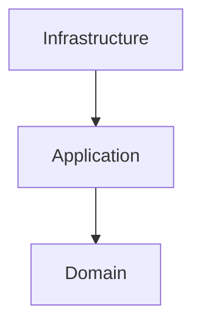

# Motor Desk


Motor Desk is a backend API for automotive repair shop management built with Kotlin and Ktor 3. The codebase follows a
hexagonal style with domain ports, application use cases, and infrastructure adapters. It manages service orders,
customers, vehicles, tasks, inventory items, approvals, authentication, service order history, and asynchronous email
notifications.

## Technologies

- Kotlin
- Ktor 3
- PostgreSQL + Exposed
- MongoDB for Service Order history
- Redis Streams for asynchronous email processing
- JWT authentication
- Docker Compose
- OpenAPI + Swagger UI

## Architecture

### Hexagonal Structure



The main code locations are:

```text
src/main/kotlin
├── domain
├── application
└── infrastructure
```

## Documentation

- [Ubiquitous Language](docs/Ubiquitous%20Language.md)
- [ADR-001 - PostgreSQL + Kotlin Exposed](docs/ADR/ADR-001%20%E2%80%94%20PostgreSQL%20+%20Kotlin%20Exposed.md)
- [ADR-002 - Redis Streams](docs/ADR/ADR-002-Redis-Streams.md)
- [ADR-003 - MongoDB Service Order History](docs/ADR/ADR-003-MongoDB-Service-Order-History.md)
- [ADR-004 - Transactional Email (historical decision, superseded)](docs/ADR/ADR-004-Azure-Communication-Services-Email.md)
- [ADR-005 - Migrating to Hexagonal Architecture](docs/ADR/ADR-005-Migrating-to-Hexagonal-Architecture.md)
- [ADR-006 - Terraform and Microsoft Azure (superseded)](docs/ADR/ADR-006-terraform-azure.md)
- [ADR-007 - Migration from Azure to AWS](docs/ADR/ADR-007-Migrate-Infrastructure-from-Microsoft-Azure-to-AWS.md)
- [Email Sending Sequence](docs/diagrams/send-email-sequence.md)
- [Technical Debt - Serializable in Domain](docs/Technical-Debt/TD-001-Serializable-in-Domain.md)
- [Business flows](docs/storytelling/)

## Business Flows

- Login / Registration
- Service Order
- Vehicle Registration
- Forgot Password

## API Documentation

- Interactive Swagger UI: `http://127.0.0.1:8080/swaggerUI`
- Static OpenAPI: `docs/index.html`

## Running the Project

### Prerequisites

- JDK 21
- Docker
- Docker Compose
- `kotlinc` (Kotlin compiler) — required for local AWS Terraform automation
- Terraform 1.10+ (for AWS infrastructure)

### Local run

Start the local dependencies with Docker Compose. Set credentials matching `mongo.user` and `mongo.password` in your
local `src/main/resources/secrets.properties`:

```powershell
$env:MONGO_USER = "motordesk"
$env:MONGO_PASSWORD = "<replace-with-a-strong-local-password>"
docker compose -f infra/docker/docker-compose-dev.yml up -d
.\gradlew.bat runDev
```

The host-run API connects to `mongodb://localhost:27017`; Compose stores data in the named `mongo_data` volume. The full
Compose application connects to the MongoDB service by its private Compose hostname. The local volume remains when the
container is recreated; remove it only when deleting the local database is intentional.

The local Docker MongoDB is separate from the AWS MongoDB service; their data is not shared.

### AWS Infrastructure

AWS is the only cloud provider configured by this repository. The application sends email through Amazon SES, and there
is no provider-selection flag or Azure runtime adapter.

See [AWS Terraform Architecture](docs/deployment/aws-terraform-architecture.md) for the implemented resources, per-environment
configuration, state backend, IAM, deployment workflow, and operational limitations.

```text
infra/terraform/aws/
├── backend/                 # One-time S3 state bucket bootstrap
├── envs/dev/                # Independent dev state
├── envs/qa/                 # Independent QA state
├── envs/prod/               # Independent production state
└── modules/application/     # Shared VPC, ECS, data services, IAM and SES
```

Terraform state uses S3 server-side encryption, versioning, public-access blocking, TLS-only bucket policy, and native
S3 locking (`use_lockfile`, Terraform 1.10+). Do not reuse any previous provider's state in AWS. Legacy state and
cloud resources are not manipulated by this repository.

Bootstrap the remote state bucket once using an AWS profile with narrowly scoped setup permissions:

```bash
terraform -chdir=infra/terraform/aws/backend init -backend=false
terraform -chdir=infra/terraform/aws/backend apply \
  -var="state_bucket_name=<globally-unique-bucket-name>" \
  -var="aws_region=us-east-2"
```

Then configure backend access and environment-specific values in your local environment (never commit state, plans, or
secret-bearing variable files):

```powershell
$env:AWS_REGION = "us-east-2"
$env:AWS_TF_BACKEND_BUCKET = "<state-bucket-name>"
terraform -chdir=infra/terraform/aws/envs/dev init `
  -backend-config="bucket=$env:AWS_TF_BACKEND_BUCKET" `
  -backend-config="region=$env:AWS_REGION"
terraform -chdir=infra/terraform/aws/envs/dev validate
terraform -chdir=infra/terraform/aws/envs/dev plan
```

For dev, `api_domain_name` is optional: when omitted, Terraform uses the ALB-generated DNS name over HTTP. Set a
custom domain to enable ACM-managed HTTPS. QA and prod require `api_domain_name`. Set `ses_from_address` in ignored
environment `.tfvars` files as needed. Terraform requests the ACM certificate and,
when `route53_zone_id` is set, creates the DNS validation record and waits for issuance. Without a Route 53 zone, use the
`certificate_validation_records` output to publish the DNS validation record externally and wait for ACM issuance
before applying the HTTPS listener. Those environments redirect HTTP to HTTPS. Set `route53_zone_id` when the matching
hosted zone is in Route 53, or create the API DNS alias externally. `desired_count` defaults to zero until an application
image exists. The AWS module provisions MongoDB as a private, single-task ECS Fargate service with an encrypted EFS data
volume and credentials in Secrets Manager; the API resolves it through private Cloud Map DNS. It is self-managed
MongoDB, not a managed database service, and does not provide database replication or multi-node failover. Review backup
retention, restore procedures, EFS performance, database sizing, cost, quotas, SES sending verification, and production
availability before any apply. PostgreSQL and ElastiCache settings, the VPC, and ALB must be reviewed against the
current Terraform plan before applying. The VPC and ALB use two available availability zones in the configured region.
PostgreSQL remains Single-AZ, and Redis automatic failover remains disabled.
Before production, replace the database administrator credentials currently injected into the application with a
dedicated least-privilege application database role and validate that role's grants.

The GitHub workflows `Terraform AWS Validation` and `Deploy AWS` validate and deploy only to AWS. Deployment is manual
and uses a dedicated IAM deploy user per environment. After applying Terraform, create an access key for each output
`github_deploy_user_name` outside Terraform, then save its `AWS_ACCESS_KEY_ID` and `AWS_SECRET_ACCESS_KEY` as secrets in
the matching GitHub Environment (`dev`, `qa`, or `prod`). Do not put access keys in Terraform state or repository
variables. Restrict who can run deployments and rotate these long-lived credentials regularly. `AWS_REGION` remains a
repository variable. Organization SCPs can also restrict creating IAM users or access keys; an organization
administrator must allow those actions if they are denied. SES sender verification and production access must be
completed in AWS before email delivery is expected to work.

The ECS service task definition and desired count are owned by the deploy workflow after initial creation, so later
Terraform applies do not revert the deployed image or scale the service back to zero.
See [the AWS operations runbook](docs/deployment/aws-migration-runbook.md) for data migration, cutover, AWS rollback,
and legacy-resource cleanup requirements.

Terraform planning requires `AWS_TF_BACKEND_BUCKET` and AWS credentials. Review every plan before applying it.

The app always uses AWS SES. ECS injects region, SES sender, and JWT metadata from Parameter Store; PostgreSQL, Redis,
MongoDB, and JWT credentials come from Secrets Manager. AWS SDK credentials come from the task role, not static access
keys. Local development uses the standard AWS SDK credential chain.

### Useful Gradle tasks

- `./gradlew test` — run unit and integration tests
- `./gradlew build` — build the project
- `./gradlew sonar` — run SonarQube analysis
- `./gradlew buildFatJar` — create a fat JAR for deployment
- `./gradlew terraformAws -PawsEnvironment=dev -PawsAction=validate` — validate AWS Terraform

## Project Notes

- The application uses Ktor DI at the composition root.
- Domain ports live under `domain/`.
- Use-case implementations live under `application/`.
- Technical integrations live under `infrastructure/`.
- AWS infrastructure is defined under `infra/terraform/aws/` and documented in ADR-007. ADR-004 and ADR-006 record
  superseded provider decisions for historical context only.
