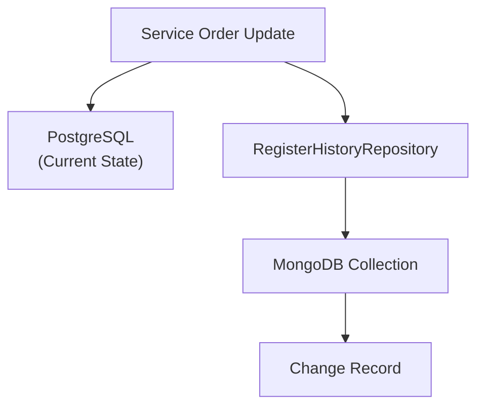

# ADR-003 - Using MongoDB for Service Order History

## Status

Accepted

------------------------------------------------------------------------

## Context

The Service Order is the main business entity in Motor Desk. During its lifecycle it changes frequently:

- status updates;
- task additions/removals;
- inventory changes;
- budget updates;
- diagnosis updates;
- customer approval.

The system needs to preserve these changes for traceability without putting history-query workloads on the transactional
database. PostgreSQL remains the source of truth for the current Service Order state.

## Decision

MongoDB is used to store Service Order history entries, separate from transactional state in PostgreSQL.

The current implementation stores a change record for each history entry, not a complete snapshot of the Service Order.
Each record contains the register identifier, a `Map<String, String>` of changes, and the change date.

## Implementation Note

The original snapshot-based description of this decision did not match the implementation. `RegisterHistoryDocument`
persists `registerId`, `changes`, and `changedAt` (along with MongoDB's document `_id`); it does not persist the complete
Service Order state. This ADR records that difference so the documented architecture describes the implemented behavior.



## Document Structure

``` json
{
  "_id": "...",
  "registerId": 123,
  "changes": {
    "status": "WAITING_APPROVAL"
  },
  "changedAt": "2025-03-08T12:34:56Z"
}
```

Each history entry creates a new document, preserving the recorded changes and their timestamp. A document is not a
standalone historical copy of the register.

## Alternatives Considered

### PostgreSQL History Tables

**Pros**

- Existing adapter
- Transactional consistency

**Cons**

- Complex schema
- Audit queries affect transactional database

**Decision:** Rejected.

### Event Sourcing

**Decision:** Rejected because it introduces unnecessary complexity.

### MongoDB

**Pros**
- Natural document storage
- Flexible storage for change records
- Horizontal scalability
- Low impact on PostgreSQL

**Cons**

- Data duplication
- Eventual consistency
- Change records do not independently represent the complete historical state

**Decision:** Accepted.

## Consequences

### Positive

- History entries are stored independently from transactional state
- Independent audit queries
- Recorded changes can be queried over time

### Negative

- The current records do not by themselves provide complete historical snapshots or guarantee reconstruction of past
  state.
- Eventual consistency between PostgreSQL updates and MongoDB history.

## Implementation Notes

- MongoDB is used exclusively for history.
- PostgreSQL remains the source of truth.
- History entries persist the register identifier, changed fields/values, and timestamp; they do not contain a full
  Service Order snapshot.
- Access is abstracted by `RegisterHistoryRepository`.
- Mongo implementation lives in `RegisterHistoryRepositoryMongoFactory`.

## Architectural Motivation

This decision aligns with:

- Separation of transactional and audit workloads
- Domain-Driven Design
- Hexagonal Architecture
- Repository single responsibility
- Separation of history queries from transactional workloads
