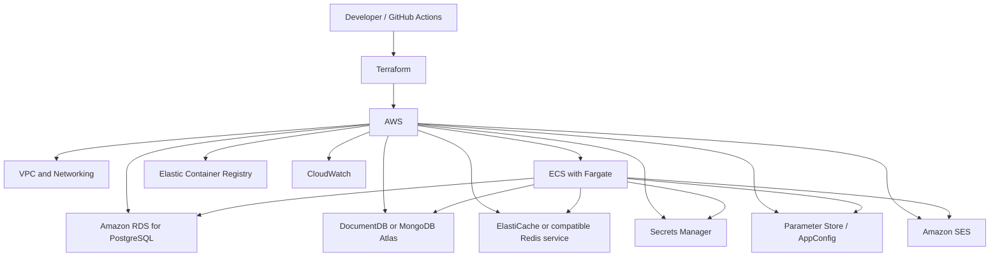

# ADR-007 — Migrate Infrastructure from Microsoft Azure to AWS

- **Status:** Accepted — the repository and application are AWS-only. Provisioning, live data migration, and cleanup of resources outside this repository remain operational tasks.
- **Date:** 2026-10-22
- **Decision:** Migrate Motor Desk cloud infrastructure from Microsoft Azure to Amazon Web Services (AWS), keeping Terraform as the Infrastructure as Code (IaC) tool.

---

## Context

Motor Desk uses Terraform to provision and manage its cloud infrastructure. The existing Azure infrastructure includes networking, PostgreSQL, Redis, MongoDB, container registry, email services, application configuration, and secret management.

The original decision to use Azure was documented in [ADR-006](ADR-006-terraform-azure.md) and was primarily motivated by the availability of an Azure student subscription, which made cloud resources accessible in an academic context.

During infrastructure development, some limitations and operational difficulties were encountered:

- **Resource quota constraints:** Azure resource quotas, particularly those affecting the planned Azure Kubernetes Service (AKS) deployment, constrained the available deployment options and led to consideration of Azure Container Apps.
- **Key Vault access issues:** HTTP 403 errors occurred when accessing secrets, requiring investigation of permissions, role assignments, and possible RBAC propagation delays.
- **Terraform state and resource management:** State synchronization, resource imports, and differences between the declared configuration and existing resources introduced additional troubleshooting work.

These observations describe challenges encountered in this project and do not imply that Azure is generally less capable or reliable than AWS.

In addition, AWS is more familiar to the developer than Google Cloud Platform (GCP). This familiarity can reduce the learning curve, simplify troubleshooting, and allow more development effort to be directed toward the application rather than cloud-specific concepts.

The project therefore requires a reassessment of the cloud provider while preserving the benefits of declarative, version-controlled infrastructure management.

## Decision

AWS was selected as the target cloud provider for Motor Desk, while Terraform will remain the Infrastructure as Code tool.

The application, infrastructure-as-code roots, and deployment workflows in this repository target AWS exclusively.
The former Azure adapters, Terraform roots, backend configuration, and deployment workflows have been removed. This
repository change does not provision AWS or destroy resources, data, or state held in external cloud accounts.

The target architecture will use managed AWS services wherever practical, reducing the operational burden of maintaining databases, application runtime infrastructure, secrets, and monitoring.

The following architecture is proposed:

This diagram represents the proposed target architecture. Specific managed services remain subject to compatibility, availability, cost, and implementation validation.

## Why AWS

### Operational Constraints Encountered in Azure

The project experienced resource quota limitations and configuration difficulties while provisioning and integrating Azure services.

Moving to AWS provides an opportunity to reassess resource availability, service selection, permissions, and deployment architecture. The migration is not expected to eliminate all cloud-provider limitations; AWS quotas, IAM policies, service availability, and regional restrictions must also be evaluated.

### Familiarity with AWS

AWS was preferred over GCP because the developer has greater familiarity with AWS.

This familiarity is relevant to a project maintained by a small development team, where operational knowledge and the ability to troubleshoot infrastructure directly affect implementation speed and maintenance effort.

Choosing AWS avoids introducing an additional learning curve that would not provide a demonstrated advantage for the current project requirements.

### Managed Services

AWS offers managed services for the project's main infrastructure requirements, including container execution, relational databases, secrets, monitoring, and email delivery.

Using these services can reduce the need to maintain supporting infrastructure manually while preserving the existing application architecture.

### Terraform Continuity

Terraform will remain the IaC tool because the project already uses it to describe infrastructure declaratively.

Retaining Terraform avoids an unnecessary change in both the cloud provider and the infrastructure management approach at the same time. The migration can focus on provider-specific resources while preserving version control, reviewability, and reproducible provisioning.

## Proposed Service Mapping

| Current Azure Service                           | Proposed AWS Replacement                                                                           |
| ----------------------------------------------- | -------------------------------------------------------------------------------------------------- |
| Azure Virtual Network                           | Amazon VPC                                                                                         |
| Azure Kubernetes Service / Azure Container Apps | Amazon ECS with AWS Fargate                                                                        |
| Azure Container Registry                        | Amazon Elastic Container Registry (ECR)                                                            |
| Azure Database for PostgreSQL                   | Amazon RDS for PostgreSQL                                                                          |
| MongoDB deployment                              | Amazon DocumentDB or MongoDB Atlas, subject to compatibility validation                            |
| Azure Cache for Redis / Redis deployment        | Amazon ElastiCache or another compatible managed Redis service                                     |
| Azure Key Vault                                 | AWS Secrets Manager                                                                                |
| Azure App Configuration                         | AWS Systems Manager Parameter Store or AWS AppConfig                                               |
| Azure Communication Services Email              | Amazon Simple Email Service (SES)                                                                  |
| Azure Monitor and related diagnostics           | Amazon CloudWatch                                                                                  |
| Terraform local state or existing backend       | Remote Terraform state backend using Amazon S3, with appropriate state locking and access controls |

The mapping is a proposal rather than a guarantee of direct equivalence. Each replacement must be validated against the application's current usage, configuration, and operational requirements.

In particular, Redis Streams support and MongoDB compatibility must be verified before selecting their final managed services.

## Alternatives Considered

### Microsoft Azure

**Advantages**

- Existing Terraform configuration and infrastructure.
- Existing integration with Azure services.
- Availability of the Azure student subscription.
- No immediate cloud-provider migration required.

**Disadvantages**

- Resource quota constraints encountered during the project.
- Troubleshooting effort related to Key Vault permissions and Terraform state/resource synchronization.
- Continued dependence on the existing Azure-specific infrastructure configuration.

**Decision**

Not selected as the target provider. The decision is based on the project's observed constraints and the developer's current needs, rather than a general conclusion that Azure is technically inferior.

---

### Google Cloud Platform (GCP)

**Advantages**

- Managed compute, database, networking, and security services.
- Support for containerized applications and infrastructure automation.
- A viable alternative for the application's architecture.

**Disadvantages**

- Lower familiarity compared with AWS.
- Additional learning and adaptation effort.
- No specific GCP advantage has been identified that justifies preferring it for the current project.

**Decision**

Rejected in favor of AWS because AWS offers a more familiar operational environment for the developer.

---

### Continue with Azure and Change the Deployment Model

**Advantages**

- Avoids a full cloud migration.
- Allows the project to continue using existing resources and configurations.
- May resolve some deployment constraints through alternative services or regions.

**Disadvantages**

- Requires further investigation and adaptation of the current Azure implementation.
- Does not address the preference for a more familiar cloud environment.
- May require additional changes to the existing infrastructure architecture.

**Decision**

Not selected as the primary approach. Azure-specific alternatives may still be appropriate when evaluating individual services, but AWS will be the target architecture.

---

### Replace Terraform with AWS CloudFormation

**Advantages**

- Native AWS infrastructure provisioning.
- Integration with AWS resource management.

**Disadvantages**

- Requires replacing the existing Terraform workflow.
- Introduces an additional migration dimension without a demonstrated need.
- Reduces continuity with the existing infrastructure-as-code implementation.

**Decision**

Rejected. Terraform will be retained.

## Consequences

### Positive

- Infrastructure will be managed through AWS services familiar to the developer.
- Terraform remains the declarative infrastructure management tool.
- Managed AWS services can reduce operational maintenance requirements.
- The application can retain its existing core technologies: Kotlin, Ktor, PostgreSQL, MongoDB-compatible storage, and Redis-based messaging.
- Infrastructure changes remain version-controlled and reviewable.
- The migration creates an opportunity to reassess service selection, access policies, and deployment requirements.

### Negative

- Existing Terraform resources and provider-specific configuration must be adapted or replaced.
- Migration requires additional development, validation, and operational effort.
- Running Azure and AWS resources in parallel may temporarily increase costs.
- Database migration introduces data consistency, backup, and recovery risks.
- Managed MongoDB-compatible and Redis services may not support every feature or behavior used by the application.
- AWS IAM, networking, quotas, and service-specific configuration introduce their own operational requirements.
- Existing Azure integrations, secrets, deployment workflows, and documentation must be updated.

## Migration Strategy

The migration should be performed incrementally, with each phase validated before proceeding to the next.

### Phase 1 — Inventory and Preparation

- Inventory existing Azure resources and Terraform configuration.
- Identify application dependencies on Azure-specific SDKs, environment variables, credentials, and endpoints.
- Document database sizes, backup procedures, and data migration requirements.
- Review AWS service quotas, regional availability, and estimated costs.
- Define the AWS environment and access-control requirements.

### Phase 2 — AWS Foundation

- Configure the AWS provider and environment-specific Terraform variables.
- Provision the VPC, subnets, routing, security groups, and required network access.
- Configure remote Terraform state with appropriate encryption, access control, and state locking.
- Establish secure access for GitHub Actions using OpenID Connect (OIDC) and short-lived credentials where the
  organization permits it; otherwise use a least-privilege IAM deploy user with credentials stored as GitHub Environment
  secrets and a documented rotation process.

### Phase 3 — Data and Supporting Services

- Provision PostgreSQL and validate schema and connection behavior.
- Select and validate the MongoDB-compatible service against the application's actual queries and data model.
- Validate Redis command support, consumer groups, acknowledgment behavior, and stream processing.
- Configure secrets, application settings, and email delivery.
- Test backups and restoration before migrating production data.

### Phase 4 — Application Deployment

- Configure ECR and build/publish the application container image.
- Deploy the application using ECS with Fargate, subject to workload and cost validation.
- Configure health checks, logging, environment variables, secrets, and network connectivity.
- Update GitHub Actions workflows to deploy to AWS.
- Run integration tests against the target services.

### Phase 5 — AWS Cutover and Legacy Resource Cleanup

- Perform final data synchronization and verify data consistency.
- Validate authentication, Service Orders, persistence, history, Redis Streams, and email notifications.
- Switch application traffic and configuration to AWS.
- Monitor errors, latency, logs, and service health.
- Use the AWS-native rollback procedure for application revisions and data recovery; the application no longer supports
  provider rollback.
- Remove legacy resources only after confirming that data is migrated, backups are recoverable, no consumers remain, and
  the resource owners approve the cleanup.

## Security and State Management

- Terraform state must not be committed to the Git repository.
- Remote state must be encrypted and protected by least-privilege access policies.
- State locking must be configured using a supported backend mechanism.
- AWS credentials and application secrets must not be hardcoded in Terraform files or committed to Git.
- GitHub Actions should use OIDC where permitted rather than long-lived AWS access keys. The current implementation
  uses dedicated IAM deploy users and GitHub Environment secrets because an organization SCP explicitly denied creation
  of the GitHub OIDC provider. This is a constrained exception: restrict access to deploy environments, rotate keys,
  and return to short-lived OIDC credentials if the organization policy changes.
- IAM permissions should follow the principle of least privilege.
- Network access to databases and internal services must be restricted to authorized workloads.
- Database backups and recovery procedures must be tested before cutover.

## Validation Criteria

The migration will be considered ready for completion when:

- Terraform can provision and update the target AWS infrastructure reproducibly.
- The application builds and deploys successfully through the updated CI/CD workflow.
- PostgreSQL data and transactional operations are validated.
- MongoDB-compatible persistence supports the required service-order history behavior.
- Redis Streams processing works correctly, including consumer groups and message acknowledgments.
- Email notifications are delivered through the selected provider.
- Secrets are supplied securely and the application can access them using its assigned permissions.
- Logs, health checks, and operational monitoring are available.
- Backup restoration and rollback procedures have been tested.
- AWS deployment, data recovery, monitoring, and rollback procedures are validated before any legacy resources are
  decommissioned.

## Related Work

- **Issue #65** — Migrate Terraform IaC from Azure to AWS.

## Related Documentation

- `infra/terraform/` — Terraform infrastructure configuration.
- `docs/ADR/ADR-006-terraform-azure.md` — Original decision to use Terraform and Azure.
- `docs/ADR/` — Architectural Decision Records.
- `README.md` — Project setup and deployment instructions.
