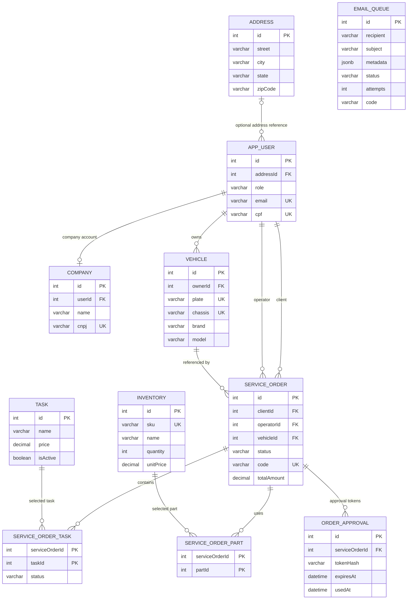
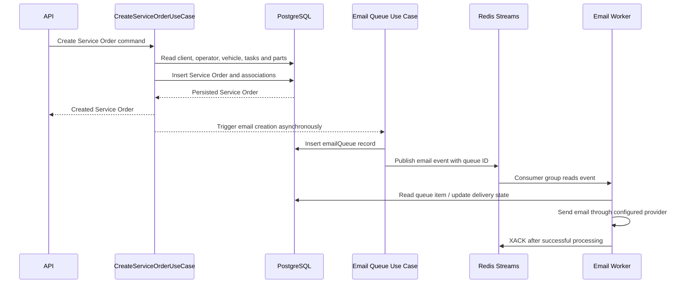
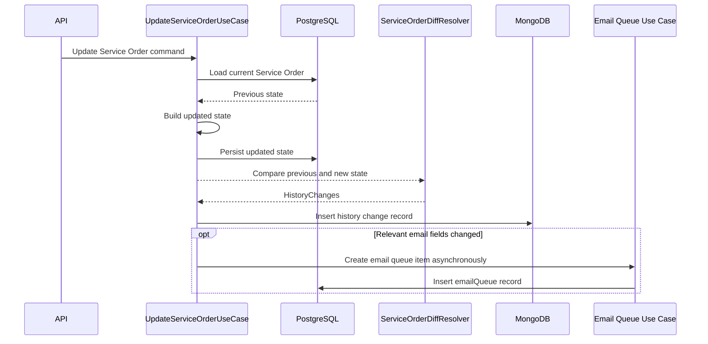
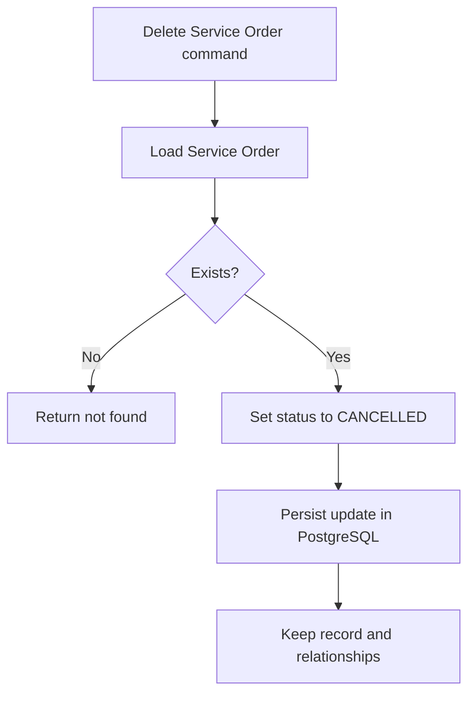

# MotorDesk Database Design — Relational Model, Data Ownership and Performance

## 1. Overview

MotorDesk uses a polyglot persistence strategy, with each technology assigned a specific responsibility:

- **PostgreSQL** is the primary transactional database and the source of truth for current business data.
- **Kotlin Exposed** implements the relational persistence layer using a code-first approach and Kotlin DSL.
- **MongoDB** stores Service Order and Service Order Task change history.
- **Redis Streams** provides asynchronous event delivery for email processing. It is a messaging mechanism, not the system of record.
- **Amazon SES** is the external email delivery provider.

This separation follows the decisions documented in ADR-001, ADR-002 and ADR-003, and the project's Hexagonal Architecture: application use cases depend on domain repository ports, while outbound adapters implement persistence and external integrations.

## 2. Relational Entity-Relationship Model

The following diagram represents the relational entities and foreign-key relationships declared in the current Exposed table definitions.

**Diagram notes**

- `PK` identifies primary keys; `FK` identifies foreign-key references; `UK` identifies unique indexes explicitly declared in the Exposed table definitions.
- The `BaseTable` abstraction supplies an integer ID primary key and `createdAt` / `updatedAt` timestamps to tables inheriting from it.
- `SERVICE_ORDER_TASK` and `SERVICE_ORDER_PART` are explicit association tables with composite primary keys.
- `EMAIL_QUEUE` is included as a PostgreSQL persistence entity, but its current schema does not declare a foreign key to `SERVICE_ORDER`. Its `code` field carries the Service Order code.
- MongoDB history collections are intentionally not represented as relational entities.

## 3. Relationships and Cardinalities

### Identity and customer data

**Address → User**

A user may reference an address through the nullable `addressId` column. The relationship is optional on the user side. The current schema does not enforce a unique address reference, so an address may be referenced by multiple users at the database level.

**User → Company**

A company references a user through `userId`, which has a unique index. This makes the relationship one-to-one from the company side: a user can be associated with at most one company record, while each company record has one referenced user.

**User → Vehicle**

Each vehicle references one owner (`ownerId`). A user can own multiple vehicles. The database enforces the owner reference through a foreign key.

### Service Order relationships

A Service Order references:

- One client through `clientId`.
- One operator through `operatorId`.
- One vehicle through `vehicleId`.

The same `users` table is used for both client and operator references. The `role` column distinguishes user roles at the application level.

A vehicle can be referenced by multiple Service Orders over time. This is important because the vehicle is a long-lived business entity, while Service Orders represent individual service events.

### Service Order ↔ Task

The relationship is many-to-many and is implemented through `service_order.serviceOrderTasks`.

The association table has a composite primary key `(serviceOrderId, taskId)` and stores a task-specific `status` value.

This design is necessary because a task's progress belongs to its execution within a particular Service Order, not to the reusable Task catalog entry.

### Service Order ↔ Inventory

The relationship is many-to-many and is implemented through `service_order.serviceOrderParts`.

The composite primary key `(serviceOrderId, partId)` prevents the same inventory item from being associated more than once with the same Service Order.

The current association table does not store quantity, unit price or a historical price snapshot. If the business later needs to preserve the exact quantity and price of each part used at order time, this relationship should evolve into a richer line-item entity.

### Service Order → Order Approval

`orderApprovals` references a Service Order and stores token-related data, including a token hash, expiration timestamp and optional usage timestamp.

The table does not currently declare a uniqueness constraint on `tokenHash` or a uniqueness constraint on `serviceOrderId`. Therefore, the schema permits multiple approval records for the same Service Order.

## 4. Database Selection and Responsibilities

### PostgreSQL — transactional source of truth

ADR-001 selected PostgreSQL because MotorDesk handles business-critical transactional operations that require ACID guarantees, relational constraints, joins and indexing.

The database is organized into schemas:

| Schema | Responsibility |
|---|---|
| `identity` | Users, addresses and companies |
| `vehicles` | Vehicle registration and ownership |
| `inventory` | Inventory catalog and stock |
| `service_order` | Service Orders, Tasks, associations and approvals |
| `email` | Email queue persistence |

Kotlin Exposed was selected because it offers an idiomatic Kotlin DSL and a code-first schema definition approach. The repositories execute database operations inside `suspendTransaction`, keeping relational operations within Exposed transaction boundaries.

PostgreSQL owns current transactional state. MongoDB and Redis do not replace it.

### MongoDB — historical change records

ADR-003 assigns MongoDB the responsibility of storing Service Order history.

The implementation uses `RegisterHistoryDocument`, which contains:

- MongoDB `_id` (`ObjectId`);
- `registerId`, containing the relational entity identifier;
- `changes`, a map of changed field names to string values;
- `changedAt`, the timestamp of the change.

The implementation defines two collection names:

- `service_order_history`
- `service_order_task_history`

The Mongo repository queries records by `registerId` and sorts them by `changedAt` and `_id` in ascending order.

This is a change-record/diff approach, not a full snapshot implementation. The adapter stores changed fields and their values, consistent with the implementation note in ADR-003.

The relational identifier is stored as a value in MongoDB rather than as a database-enforced foreign key. This is intentional: MongoDB is an independent history store, and PostgreSQL remains authoritative for the current state.

### Redis Streams — asynchronous event transport

ADR-002 selected Redis Streams to decouple email processing from the main Service Order request.

The current implementation uses:

- Stream key: `email`
- Consumer group: `email-workers`
- Consumer name: `worker-1`

`RedisEmailPublisherImpl` publishes a serialized event containing an event key and a payload. The current payload is the email queue record ID.

The consumer reads with `XREADGROUP`, dispatches the message to a matching handler and acknowledges successful processing with `XACK`. Retry-class failures are handled through `XNACK`.

Redis is not the durable business record for email status. The email queue in PostgreSQL stores the state and attempts; Redis transports the processing event.

## 5. Core Service Order Data Flows

### 5.1 Creation

The `CreateServiceOrderUseCaseImpl` flow is:

1. Load the client, operator, vehicle, requested Tasks and inventory items.
2. Build the Service Order with status `CREATED`.
3. Generate its public code.
4. Check whether a Service Order with that code already exists.
5. Persist the Service Order and its associations in PostgreSQL through `ServiceOrderExposedRepositoryImpl`.
6. Trigger email queue creation asynchronously.

The email queue use case creates an `email.emailQueue` record with recipient, subject, metadata, status `PENDING`, attempts and Service Order code. It then publishes the resulting queue ID to Redis Streams.

The diagram describes the intended responsibility boundary. The queue creation and event publication are asynchronous and are not part of a single distributed transaction with the Service Order insert.

### 5.2 Update and history

`UpdateServiceOrderUseCaseImpl` performs the following steps:

1. Load the current Service Order by its code.
2. Resolve the new Task and inventory selections.
3. Apply the requested status, complaint, diagnosis, operator, Task and inventory changes.
4. Persist the updated Service Order in PostgreSQL.
5. If relevant fields changed (total price, Tasks, parts or status), trigger email queue creation.
6. Trigger history creation.

`CreateServiceOrderHistoryUseCaseImpl` uses `ServiceOrderDiffResolverImpl` to compare the previous and new Service Order states. The current diff implementation records changes for status, complaint, diagnosis, operator, Tasks and inventory items.

The resulting `HistoryChanges` is written to MongoDB through the history repository.

**Consistency consideration:** the PostgreSQL update and MongoDB history insertion are separate persistence operations. The current use case launches history creation asynchronously, so the two writes are not protected by one distributed transaction. A process failure between these operations may result in a committed Service Order update without a corresponding history record.

A transactional outbox or retryable history-event mechanism could be considered if stronger delivery guarantees become necessary.

### 5.3 Deletion

Service Orders are not physically deleted by the current repository implementation.

`DeleteServiceOrderUseCaseImpl` loads the record and invokes `ServiceOrderExposedRepositoryImpl.delete`. The repository updates the status to `CANCELLED`.

This preserves the record and its relational references, preventing historical business information from disappearing due to a delete operation.

The implementation does not physically remove the Service Order or cascade-delete its related records.

### 5.4 History retrieval

`GetServiceOrderHistoryUseCaseImpl` delegates to `ServiceOrderHistoryRepository`. The Mongo adapter queries the appropriate history collection by the Service Order identifier and returns entries ordered by change timestamp and MongoDB `_id`.

The historical store allows audit-oriented reads without requiring all changes to be maintained in the primary transactional tables.

## 6. Email Queue Data Model

The `email.emailQueue` table is an important part of the persistence design and should be considered independently from Redis.

| Field | Purpose |
|---|---|
| `id` | Queue record identifier |
| `recipient` | Destination email address |
| `subject` | Email subject |
| `metadata` | JSONB payload (`ServiceOrderEmailMetadata`) |
| `status` | Processing state, defaulting to `PENDING` |
| `attempts` | Number of processing attempts |
| `errorMessage` | Last recorded failure message |
| `code` | Associated Service Order code |
| `createdAt`, `updatedAt` | Record timestamps |

The `metadata` column uses PostgreSQL `JSONB` because the email payload contains structured Service Order and client-address data. This avoids introducing a large set of email-specific relational columns while keeping the queue record durable and queryable in PostgreSQL.

The email queue repository supports creation, retrieval by ID, attempt registration and failure recording.

The current table does not declare a foreign key from `code` to `service_order.serviceOrders.code`. This means the association is maintained by application-level data rather than referential integrity enforced by PostgreSQL.

The Redis event currently contains the email queue ID, keeping the message small and allowing the worker to retrieve the persisted queue item.

## 7. Primary Keys, Constraints and Indexes

### Explicitly declared constraints

| Table | Constraint | Rationale |
|---|---|---|
| `users` | Unique `email` | Prevent duplicate email identities |
| `users` | Unique `cpf` | Prevent duplicate individual identifiers |
| `company` | Unique `cnpj` | Prevent duplicate company identifiers |
| `company` | Unique `userId` | Enforce at most one company record per user |
| `vehicles` | Unique `plate` | Prevent duplicate vehicle plates |
| `vehicles` | Unique `chassis` | Prevent duplicate chassis identifiers |
| `inventory` | Unique `sku` | Prevent duplicate inventory SKUs |
| `serviceOrders` | Unique `code` | Enforce unique public Service Order codes |
| `serviceOrderTasks` | Composite PK `(serviceOrderId, taskId)` | Prevent duplicate Task associations |
| `serviceOrderParts` | Composite PK `(serviceOrderId, partId)` | Prevent duplicate inventory associations |

Foreign-key references are declared for the relationships shown in the ER diagram.

### Query patterns and performance

The main query patterns visible in the repository include:

- Service Orders by client ID.
- Service Orders by vehicle ID.
- Service Order by public code.
- Service Order by primary key.
- Task progress update by Service Order ID and Task ID.
- History entries by `registerId`, ordered by `changedAt` and `_id`.
- Email queue retrieval by ID.
- Approval-token lookup by token hash.

Unique indexes support lookups for public Service Order code, user email/CPF, vehicle plate/chassis, inventory SKU and company CNPJ.

The composite primary keys on association tables support lookups that start with `serviceOrderId`. The history repository filters by `registerId`, so a MongoDB index on `registerId` with `changedAt` (and potentially `_id`) should be evaluated as history volume grows.

### Indexes to evaluate

The current Exposed table declarations do not show explicit indexes for all frequently queried foreign-key columns. The following indexes should be evaluated using PostgreSQL query plans and representative data volumes:

- `service_order.serviceOrders(clientId)` — customer Service Order history.
- `service_order.serviceOrders(vehicleId)` — vehicle service history.
- `service_order.serviceOrders(operatorId)` — operator workload.
- `service_order.orderApprovals(tokenHash)` — approval token lookup.
- `service_order.serviceOrderTasks(taskId)` — reverse Task association lookup.
- `service_order.serviceOrderParts(partId)` — reverse inventory association lookup.
- `email.emailQueue(status, createdAt)` — pending/failed email processing and operational monitoring.
- `email.emailQueue(code)` — email records associated with a Service Order code.

These are recommendations, not claims that the indexes already exist. Indexes should be added based on observed query plans and workload, since every additional index increases write and storage costs.

## 8. Consistency and Performance Trade-offs

### Transactional consistency

PostgreSQL is the authority for current Service Order, user, vehicle, inventory, Task and email queue state. Operations performed through Exposed repositories run inside `suspendTransaction`.

This protects relational operations within an individual transaction boundary. However, it does not automatically provide atomicity across PostgreSQL, MongoDB and Redis.

### History consistency

MongoDB history is written separately from the PostgreSQL update. The asynchronous approach limits impact on the request path, but introduces a possible gap between current state and audit history.

For stronger guarantees, a future improvement could persist an outbox event in the same PostgreSQL transaction as the Service Order update, then let a worker reliably publish it to MongoDB and acknowledge completion.

### Email delivery consistency

The PostgreSQL queue record is durable, while Redis Streams provides asynchronous dispatch. This avoids treating a transient event as the only representation of email delivery state.

However, queue persistence and Redis publication are separate operations. A failure after inserting the queue item but before publishing the event can leave a pending item without a corresponding Redis message. A retry/reconciliation mechanism or transactional outbox would reduce this risk.

### Inventory consistency

The current relational model associates inventory records with Service Orders but does not persist a quantity or price snapshot in the association table. It also does not show a stock-decrement operation in the Service Order repository implementation inspected for this model.

If inventory consumption becomes part of the Service Order confirmation process, stock updates should be performed transactionally with the relevant order changes, with explicit rules against negative stock and concurrent overselling.

## 9. Known Limitations and Future Improvements

The following points should be evaluated as the project evolves:

1. **History delivery reliability:** consider a transactional outbox or retryable event delivery so that every committed Service Order update eventually has a history record.
2. **Email event reliability:** reconcile pending PostgreSQL queue records with Redis events or use an outbox pattern.
3. **Inventory line items:** replace the simple many-to-many association with a richer entity when quantity, unit price and stock movement audit are required.
4. **Foreign-key query indexes:** validate execution plans and add indexes for high-frequency foreign-key filters.
5. **Approval token constraints:** evaluate a unique index on `tokenHash` and indexes for active/expired approval queries.
6. **Email queue indexes:** evaluate status and creation-time indexes for worker polling and monitoring.
7. **History indexes:** evaluate compound indexes for `registerId` and chronological retrieval.
8. **Business-level constraints:** consider database checks for non-negative quantities, valid mileage/year ranges and other invariants that must hold regardless of the application entry point.
9. **Schema migrations:** maintain controlled, versioned schema migrations as the code-first definitions evolve.

These are improvement opportunities, not descriptions of existing constraints.

## 10. References

- [ADR-001 — PostgreSQL as the Primary Relational Database](ADR/ADR-001%20%E2%80%94%20PostgreSQL%20+%20Kotlin%20Exposed.md)
- [ADR-002 — Redis Streams for Asynchronous Notification Processing](ADR/ADR-002-Redis-Streams.md)
- [ADR-003 — MongoDB for Service Order Update History](ADR/ADR-003-MongoDB-Service-Order-History.md)
- [Ubiquitous Language](Ubiquitous%20Language.md)
- [Service Order API documentation](index.html)
- [Service Order flow diagram](service-order-flow.png)

The ER diagram and this document are based on the Exposed table definitions and outbound adapter implementations currently present in the repository. Index recommendations and future improvements are explicitly identified as such.
