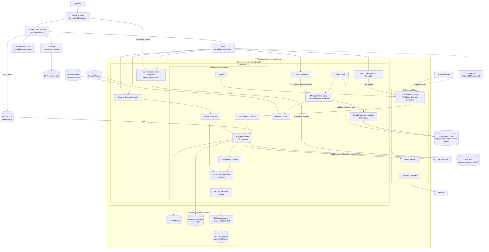

# Infraestrutura AWS do Motor Desk

Diagrama da arquitetura EKS-only declarada pelo Terraform e pelos manifests/Helm em `infra/kubernetes/`. Representa a
configuração desejada no repositório, não confirma que os recursos já foram provisionados na conta AWS.

## Operação e persistência

- Terraform provisiona VPC, subnets, Security Groups, EKS, Node Groups, IAM/Pod Identity, RDS, ElastiCache, EFS, ECR e ACM.
- YAML declara Deployments, Services, Ingress, HPA, PDB, ConfigMaps, SecretStores/ExternalSecrets e StatefulSet.
- Helm instala AWS Load Balancer Controller, External Secrets Operator, Metrics Server, Cluster Autoscaler, New Relic
  Kubernetes observability e, com Route 53 configurado, ExternalDNS.
- CloudWatch permanece como destino dos logs de workloads e control plane; New Relic coleta métricas/eventos Kubernetes e
  recebe a telemetria OpenTelemetry já exportada pela API.
- MongoDB reutiliza o EFS/access point existente; PV usa `Retain` e os recursos EFS têm `prevent_destroy`.
- ALB e endpoint de domínio substituem API Gateway/NLB para o tráfego da aplicação. Verifique a janela de manutenção na
  [ADR-008](../ADR/ADR-008-Amazon-EKS-Runtime.md) e no [runbook](../deployment/aws-migration-runbook.md).
